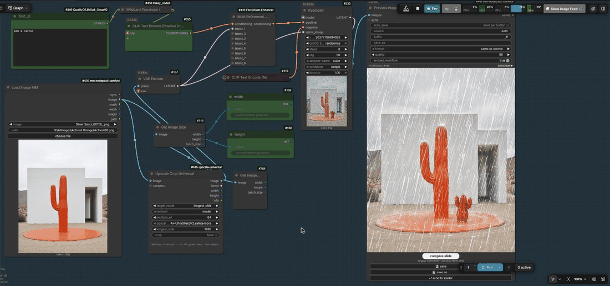

<p align="left">
  
</p>

# MM Nodepack

Four ComfyUI nodes for working with real files: load an image or a whole folder from disk, compare and save results next to the source, resize and crop, and talk to local or remote LLMs.

Together they close the loop. A result goes straight back into the loader, so one image can be edited step by step, a folder can be captioned image by image, and frames can be processed in order for a clip.



*Flux.2 Klein edit loop: "add a cactus" → send → "make it blue" → send → "pink and white striped" → send.*

## What you can do with it

- **Edit in a loop.** Run, look, press **send to loader**, write the next prompt. Each step is saved as `name_1`, `name_2`, … and nothing is overwritten.
- **Caption a folder.** Load Image MM in folder mode steps through the files; LLM Multitool MM describes each image; the `path` output tells a text-saving node which file each caption belongs to.
- **Work on frames.** Step through an image sequence with `index`, process each frame and save it beside the original, ready to assemble into a clip.
- **Keep paths.** Every image carries its full path, so saves, captions and other nodes know where the source lives.

## Nodes

### Load Image MM

Loads a single image or a folder.

- Single mode: pick a file with the OS dialog, drag & drop, paste, choose from `input/`, or type a full path (the path wins).
- Folder mode: choose a folder; `batch_mode` steps through it `incremental` or `random`, `index` is the position (1-based).
- Outputs `image`, `mask`, `width`, `height`, `path` (absolute), `image_list` (the whole folder in filename order) and `index`.

### Preview & Save MM

Shows the results, compares them with the source image and saves the ones you keep.

- Compare with a slider or by holding the mouse on the preview.
- **save** writes next to the source as `name_1`, `name_2`, … (`suffix`, `#` = next free number), **save as…** lets you pick the place.
- **send to loader** saves the result and puts it into the loader for the next run.
- `auto_save` saves every run; `auto_send` sends every run back to the loader.
- `source` stays hidden while the loader is clear; it appears when several Load Image MM nodes could be the source.
- Formats: PNG (with the workflow embedded), JPG, WebP. Without a loader the files go to `output/preview_#.png`.

### Upscale Crop MM

Resizes an image and crops it to an exact format.

- Size by percent, factor, shortest or longest side, megapixels or a custom box; down as well as up.
- `method` is `lanczos` by default; `upscaler model` uses a model from `models/upscale_models`.
- Crop to 4:5, 1:1, 16:9 and more, or a custom box; position, offsets, random position with a seed.
- The live preview shows the result size, and the crop window can be dragged.
- Outputs `image`, `width`, `height` and `info` (what was done).

### LLM Multitool MM

Sends text, or text with images, to an LLM and returns the answer.

- Works with llama.cpp, NInfer, Ollama, Unsloth Studio and any OpenAI-compatible server.
- Can start its own `llama-server` for a GGUF model found on your machine (port `8081`, change with `LLM_MULTITOOL_PORT`).
- **unload model** and `unload_after` free the GPU again for rendering.

### Free GPU

A small tile in the top action bar shows how much GPU memory ComfyUI holds; a click unloads all models.

## Install

1. **ComfyUI Manager**: search for **MM Nodepack** and install.
2. **git**: clone into `ComfyUI/custom_nodes` and restart ComfyUI:

   ```bash
   cd ComfyUI/custom_nodes
   git clone https://github.com/metamountain/mm-nodepack-comfyui
   ```

No extra Python dependencies. For the own local LLM server, put `llama-server` on your `PATH` or point `LLAMA_SERVER_BIN` at it; otherwise any running LLM server works.

## Shared server

When ComfyUI serves other people, the pack only reads from `input/` and `output/`, only writes to `output/`, and never overwrites a file. OS dialogs only open for the browser on the ComfyUI computer itself.

- `MM_NODEPACK_SHARED_SERVER`: `1` / `0` forces the mode on or off; without it the mode switches on for a non-loopback `--listen` address.
- `MM_NODEPACK_LLM_PROFILES`: the LLM servers users may call; other targets are refused.

## License

MIT
