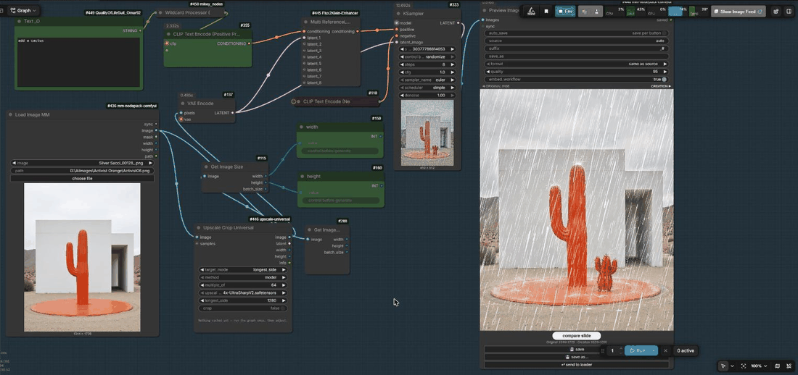

# MM Nodepack

**Load Image and Preview Image are the most used nodes in ComfyUI, and they deserve an overhaul.**
This pack gives you both with everything you need for editing images where they live:

- **Real paths.** "choose file" opens your system file dialog and keeps the real path. Nothing is copied to `input/`.
- **Handy outputs.** `image`, `mask`, `width`, `height`, `path`, so you don't need a Get Image Size node. One `sync` link carries original, path, mask, size and format to the preview.
- **Compare built in.** Original vs. result under the image: slide, hold or off. No extra comparer node.
- **Save next to the source.** `house.png` → `house_1.png`, `house_2.png`, …, never overwrites.
  **save as…** opens the system dialog in the source folder.
- **Iterate.** **send to loader** puts the result back into the loader, so the next run edits the new image.
- **One node instead of three.** Preview Image MM replaces Preview Image + Save Image + an image comparer.

> **Prototype, still in the debugging phase.** Feedback and bug reports are very welcome. Feel free to comment or open an issue.



*Flux.2 Klein edit: "add a cactus" → send → "make it blue" → send → "pink and white striped" → send.*

## Nodes

### Load Image MM
- **choose file** opens your normal system file dialog (Windows, macOS, Linux with zenity/kdialog).
  The real path shows in the node at once, before you run anything. No copy in `ComfyUI/input`.
- `path` – full file path; wins over the upload list. You can also paste a path.
- Without a desktop (server, container) or from another computer, **choose file** is the normal upload.
- Outputs: `sync` (one link to Preview Image MM: path, original, mask, size, format), `image`, `mask`,
  `width`, `height`, `path`.

### Preview Image MM
- Shows the result with a compare widget under the image: **compare slide** (move the mouse),
  **compare hold** (press to see the original, the default), **compare off**.
- **send to loader** – saves as `_#` and puts it into the Load Image MM, so the next run edits the new image.
- **open folder** – shows the last saved file in Explorer (else the folder the next save goes to);
  only in a browser on the ComfyUI computer.
- **save** – next free `_#` name next to the source, never overwrites.
- **save as…** – your system "save as" dialog, starting in the source folder.
- `auto_save` on: every run saves all images. `suffix` (default `_#`, `#` = next free number),
  `save_as` (name or full path), `format` (same as source / png / jpg / webp), `quality`, `embed_workflow`.
- `auto_send` on: after every run the result goes to the Load Image MM like **send to loader**
  (with `auto_save` on, the auto-saved file is used – no second copy).
- A button an auto switch already covers is greyed out: **save** with `auto_save`, **send to loader** with `auto_send`.
- Without a `sync` link, `source = auto` uses the Load Image MM upstream.

## Install

ComfyUI Manager / Comfy Registry: search **MM Nodepack**. Or:

```
cd ComfyUI/custom_nodes
git clone https://github.com/metamountain/mm-nodepack-comfyui
```

No extra Python packages.

## Notes

- Images pasted with Ctrl+V have no home folder: **save** then asks where to save.
- Opened from another computer (`--listen`), saving is limited to the ComfyUI output folder.

## Status: Testing Phase

> ⚠️ **This pack is still in the testing/debugging phase.**
> Things may break, behave unexpectedly, or change without notice.
> **Bug reports are very welcome** — please open an issue on GitHub with:
> - OS (Windows / macOS / Linux) + ComfyUI version
> - What you did (steps to reproduce)
> - What happened vs. what you expected
> - Screenshot if possible
>
> Comments and feedback on any issue are appreciated.

## License

## License

MIT
